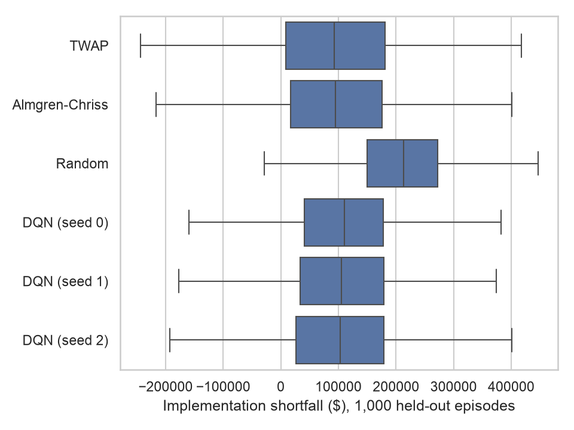
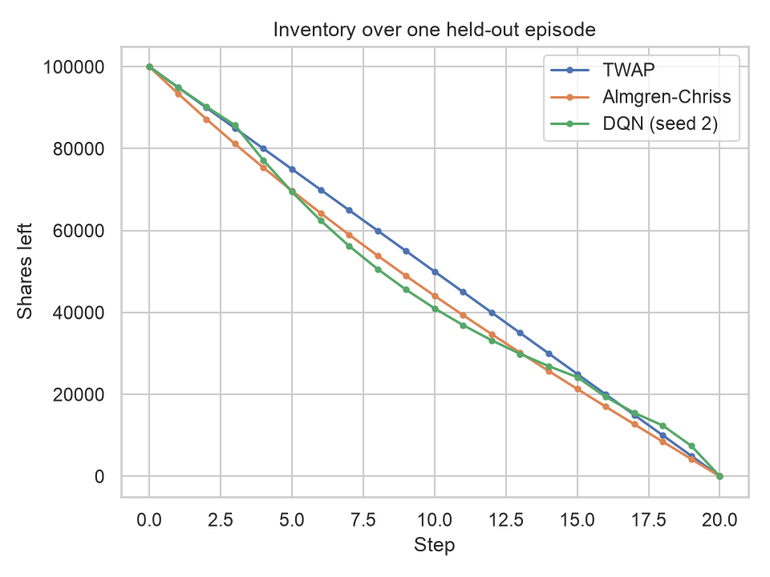

# RL trade execution: DQN vs TWAP and Almgren-Chriss

A PyTorch DQN that learns how to sell a large order (100,000 shares over 20 steps) on a **simulated** market,
compared against TWAP and the Almgren-Chriss optimal schedule. Cost = implementation shortfall
(arrival value minus cash received).

## Setup
```bash
pip install -r requirements.txt
pytest                # simulator + baseline tests
python train.py       # 3 seeds x 5,000 episodes, logged to MLflow (`mlflow ui` to view)
python evaluate.py    # 1,000 held-out episodes -> results/
```

## Model
- **Market** (`env.py`): discrete Almgren-Chriss model. Arithmetic random-walk price (sigma = $0.50/step),
  linear temporary impact (fill = price - eta * shares) and permanent impact (price drops gamma * shares).
  Anything unsold at the last step is force-liquidated.
- **Agent** (`dqn.py`): 2-layer MLP Q-network, replay buffer, target network, epsilon-greedy.
  State = time left, shares left, last price move. Actions = sell 0 / 5 / 10 / 20 / 40% of remaining.
- **Reward**: mark-to-market per step (impact cost + P&L on shares still held). It sums exactly to minus the
  shortfall but carries one step of price noise instead of the accumulated drift, which stabilised training.

## Results
1,000 held-out episodes, same random price paths for every policy:

| Policy | Mean shortfall ($) | Std ($) | Mean vs TWAP |
|:--|--:|--:|--:|
| TWAP | 94,053 | 124,018 | +0.0% |
| Almgren-Chriss (risk aversion 1e-6) | 95,293 | 115,665 | +1.3% |
| Random (same action set) | 206,073 | 95,508 | +119.1% |
| DQN, seed 0 | 109,248 | 103,373 | +16.2% |
| DQN, seed 1 | 104,846 | 107,076 | +11.5% |
| DQN, seed 2 | 101,094 | 111,161 | +7.5% |




**The DQN does not beat TWAP on mean cost, and in this market it can't.** With a pure random walk and linear
impact, TWAP is the optimal schedule for a risk-neutral seller (Almgren-Chriss with zero risk aversion), and
the price history carries no predictive signal. The DQN learns a sensible schedule (roughly half the cost of
random) that sells slightly faster than TWAP, so it lands between TWAP and a risk-averse schedule:
7-16% higher mean cost, 10-17% lower standard deviation.

## Limitations
- Simulated market only: random-walk prices, linear impact, no spread, no order book, no real data.
- Small discrete action set; TWAP itself can't be expressed exactly on it (closest grid version costs ~2% more).
- Three training seeds; results vary noticeably across seeds.
- Next steps: a market with exploitable structure (mean reversion, intraday volume patterns), a risk-adjusted
  reward, and real order book data.
